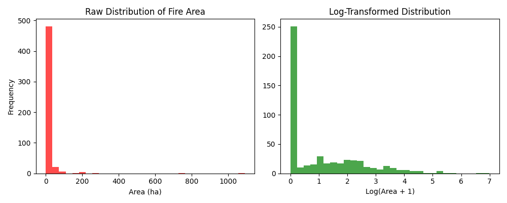
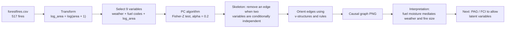

# Causal Discovery in Wildfire Data

What actually *causes* a large forest fire, as opposed to what merely correlates with it? This project applies the **PC algorithm**, a constraint-based causal discovery method, to the UCI Forest Fires data to recover the causal graph (a DAG) behind fire size.



*Burned area is extremely skewed (left). A `log(area + 1)` transform makes it usable for statistical tests (right).*

---

## Summary

Fire size in this dataset is notoriously hard to predict from weather alone. Rather than fitting another predictive model, this project asks a structural question: **which variables directly affect fire size, and which only appear related through something else?**

## Key Findings

- Fire size is **independent of local weather** once fuel moisture is accounted for.
- Fuel moisture **mediates** the relationship between weather and fire size.
- That pattern points to **unobserved (latent) drivers**, such as human suppression, that the dataset does not record.
- The PC algorithm assumes there are no hidden variables, so a model that allows them, such as a **Partial Ancestral Graph (PAG)**, is the natural next step.

## Dataset

The [UCI Forest Fires dataset](https://archive.ics.uci.edu/dataset/162/forest+fires) (Cortez & Morais, 2007) describes fires in the Montesinho natural park in northeastern Portugal.

| Property | Value |
|---|---|
| Observations | 517 |
| Columns | 13 |
| Fires with zero burned area | 247 (47.8%) |
| Median / mean / max burned area (ha) | 0.52 / 12.85 / 1090.84 |
| Skewness of `area` / `log(area + 1)` | 12.85 / 1.22 |

**Variables used in the graph (9)**

| Variable | Meaning |
|---|---|
| `temp`, `RH`, `wind`, `rain` | Weather: temperature, relative humidity, wind speed, rainfall |
| `FFMC`, `DMC`, `DC` | Fuel moisture codes from the Fire Weather Index system |
| `ISI` | Initial spread index |
| `log_area` | `log(area + 1)` of the burned area |

Spatial coordinates, month, and day are left out of the graph.

## Requirements

```
pandas
numpy
matplotlib
causal-learn
pydot
```

Rendering the graph to a PNG also needs the [Graphviz](https://graphviz.org/download/) program installed on your system, because `pydot` calls it.

## Installation

```bash
git clone https://github.com/woojook/project-report-woojook.git
cd project-report-woojook
pip install -r requirements.txt
```

## Examples

```bash
python distribution.py   # writes data_distribution.png
python analysis.py       # writes forest_fire_graph2.png (the causal graph)
```

## Parameters

| Name | Value | Description |
|---|---|---|
| Algorithm | PC (`causallearn`) | Constraint-based causal discovery |
| Independence test | Fisher-Z | Conditional independence test for continuous data |
| `alpha` | `0.2` | Significance level for each independence test |
| Target transform | `log(area + 1)` | Handles zero-area fires and heavy right skew |

## Returns

- `forest_fire_graph2.png`: the estimated causal graph over the 9 variables.
- `data_distribution.png`: the raw and log-transformed distributions of burned area.

## How It Works



**The idea in three steps**

1. Start with every pair of variables connected.
2. Remove the edge between two variables if some set of other variables makes them statistically independent (tested with Fisher-Z).
3. Orient the remaining edges using patterns that independence tests can identify (v-structures, then propagation rules).

```python
df["log_area"] = np.log(df["area"] + 1)
cols = ["temp", "RH", "wind", "rain", "FFMC", "DMC", "DC", "ISI", "log_area"]
cg = pc(df[cols].to_numpy(), alpha=0.2)
```

## Notes

- **Why log-transform the area?** With 48% zero-area fires and a skewness above 12, the raw variable violates the assumptions behind a Fisher-Z test. The transform brings the skewness down to about 1.2.
- **Why `alpha = 0.2`?** It is deliberately lenient. A higher alpha removes fewer edges, which produces a denser graph and is less likely to miss real dependencies, at the cost of more false edges.
- **Why causal discovery rather than prediction?** A predictive model can score well using variables that are only correlated with fire size. A causal graph distinguishes direct drivers from variables that act only through others.

## Limitations

- PC assumes **no unobserved common causes**. The finding that latent factors matter means this assumption is probably violated, which is why PAG-based methods are recommended as a follow-up.
- Fisher-Z assumes roughly linear, Gaussian relationships. Even after the log transform, `log_area` is still skewed (about 1.2) and has a point mass from zero-area fires.
- One run at one `alpha`. A sensitivity analysis across several significance levels, or bootstrapped edge stability, would show which edges are robust.
- Only 517 observations from a single park.

## Project Layout

```
.
├── analysis.py             # runs PC and renders the causal graph
├── distribution.py         # plots raw vs. log-transformed burned area
├── forestfires.csv         # UCI Forest Fires data
├── forest+fires.zip        # original archive
├── data_distribution.png   # figure produced by distribution.py
└── requirements.txt
```

## References

1. Cortez, P., & Morais, A. (2007). A data mining approach to predict forest fires using meteorological data. *Proceedings of the 13th EPIA 2007*, 512-523.
2. Spirtes, P., Glymour, C., & Scheines, R. (2000). *Causation, Prediction, and Search* (2nd ed.). MIT Press.
3. Zheng, Y., et al. (2024). Causal-learn: Causal discovery in Python. *Journal of Machine Learning Research*, 25(60), 1-8.
4. UCI Machine Learning Repository, Forest Fires: <https://archive.ics.uci.edu/dataset/162/forest+fires>

## Author

Woojoo Kim, Carnegie Mellon University.
